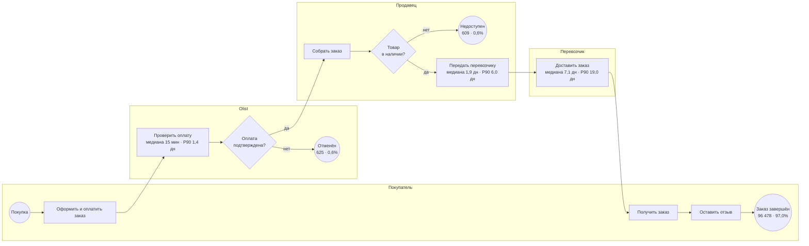

# Процесс выполнения заказа: AS-IS

| Параметр | Значение |
|---|---|
| Версия | 1.0 |
| Дата | 23.10.2026 |
| Источник цифр | `src/04_process_analysis.py`, `sql/03_process_as_is.sql` |
| Отвечает на | BQ-07 |

## 1. Схема процесса

Отмены (`canceled`) возможны на разных шагах; на схеме они показаны на шаге оплаты для упрощения.

## 2. Метрики этапов

Доставленные заказы с корректным порядком дат: **95 082**.

| Этап | Владелец | Среднее, дн | Медиана, дн | P90, дн |
|---|---|---|---|---|
| 1. Подтверждение оплаты | Olist | 0,40 | 0,01 | 1,39 |
| 2. Сборка и передача перевозчику | Продавец | 2,85 | 1,85 | 6,02 |
| 3. Доставка | Перевозчик | 9,36 | 7,11 | 18,95 |
| **Итого: от заказа до получения** | | **12,62** | **10,27** | **23,16** |
| Обещанный срок | Olist | 23,74 | 23,24 | 34,29 |

**Доставка перевозчиком — самый долгий этап:** 69% медианного срока и самый большой разброс (P90 почти втрое выше медианы).

## 3. Потери и выполнение обещания

| Показатель | Значение |
|---|---|
| Доставлено | 96 478 (97,0%) |
| Потеряно: отменено + недоступно | 1 234 (1,2%) |
| В процессе на момент выгрузки | 1 729 (1,7%) |
| Доставлено раньше обещанной даты | 91,9% |
| Доставлено в день обещания | 1,3% |
| **Доставлено с опозданием** | **6,8% (6 534 заказа)** |
| Средний запас до обещанной даты | 11,9 дн |
| Опоздание у опоздавших: среднее / медиана | 10,6 / 7 дн |

## 4. Аномалии дат (DQ-14)

| Аномалия | Заказов | Решение |
|---|---|---|
| Передача перевозчику раньше подтверждения оплаты | 1 350 | Исключены из расчёта длительности этапов |
| Получение покупателем раньше передачи перевозчику | 23 | Исключены |
| Нет даты подтверждения или передачи | 15 | Исключены |

## 5. Выводы AS-IS

1. Процесс почти не теряет заказы (1,2%), проблема не в потерях, а в **сроках**.
2. Обещанный срок в среднем в 2 раза длиннее фактического: Olist закладывает большой запас, поэтому 92% заказов приходят раньше срока.
3. Несмотря на запас, **6,8% заказов опаздывают**, в среднем на 10 дней.
4. Главный вклад в срок вносит перевозчик; где именно возникают опоздания — в `05_diagnosis.md`.
