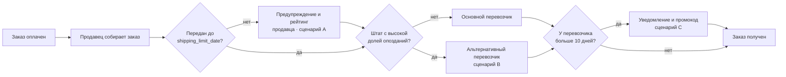

# TO-BE и сценарии решений

| Параметр | Значение |
|---|---|
| Версия | 1.0 |
| Дата | 23.10.2026 |
| Источник цифр | `src/04_process_analysis.py`, раздел «Этап 6» |
| Отвечает на | BQ-08 |

## 1. Базовая линия (AS-IS)

| Метрика | Значение |
|---|---|
| Доля опозданий | 6,77% (6 534 заказа) |
| Средняя оценка | 4,156 |
| Доля оценок 1–2 | 12,81% |

## 2. Как считался эффект

> **Эффект = число предотвращённых опозданий × разница метрики между опоздавшими и вовремя доставленными заказами**

Разница из данных (`05_diagnosis.md`): опоздание снижает оценку на 2,02 балла (4,29 → 2,27) и повышает вероятность негативного отзыва на 53 п.п. (9,3% → 62,4%).

Каждый сценарий оценён в двух вариантах: **100%** — изменение сработало полностью, **50%** — реалистичная оценка.

## 3. Сценарии

### 0. Ничего не делать
Опоздания 6,8%, треть негативных отзывов приходится на них. Затрат нет, проблема сохраняется.

### A. SLA для продавцов на передачу перевозчику
**Суть:** контроль срока `shipping_limit_date`: рейтинг продавца, предупреждение после первого нарушения, понижение в выдаче и штраф при систематических нарушениях.
**Логика:** у нарушивших срок доля опозданий 20,8%, у уложившихся 5,4%. Если нарушители станут дисциплинированными, их доля опозданий упадёт до 5,4%.

| | 100% | 50% |
|---|---|---|
| Опозданий меньше | 1 346 | 673 |
| Доля опозданий | 6,77% → 5,38% | 6,77% → 6,08% |
| Средняя оценка | 4,156 → 4,184 | 4,156 → 4,170 |
| Доля негатива | 12,81% → 12,06% | 12,81% → 12,43% |

### B. Второй перевозчик в проблемных штатах (MA, CE, BA, RJ, PA)
**Суть:** подключить альтернативного перевозчика там, где доля опозданий 12,4%, и довести её до уровня остальных штатов (5,4%).

| | 100% | 50% |
|---|---|---|
| Опозданий меньше | 1 290 | 645 |
| Доля опозданий | 6,77% → 5,44% | 6,77% → 6,10% |
| Средняя оценка | 4,156 → 4,183 | 4,156 → 4,169 |
| Доля негатива | 12,81% → 12,09% | 12,81% → 12,45% |

Пилот только в RJ (больше всего опозданий в штуках): −824 опоздания при 100%, −412 при 50%.

### C. Проактивное уведомление и компенсация при риске опоздания
**Суть:** если заказ у перевозчика дольше 10 дней (медиана 7,1), покупатель получает уведомление с новой датой и промокод.
**Важно:** сценарий не уменьшает опоздания, а смягчает реакцию. Эффект нельзя посчитать из исторических данных, это **допущение**, которое проверяется A/B-тестом.

| Если негатив у опоздавших снизится на | Негативных отзывов меньше | Доля негатива |
|---|---|---|
| 20% | 797 | 12,81% → 11,98% |
| 10% | 398 | 12,81% → 12,39% |

## 4. Сравнение

| Критерий | A. SLA продавцов | B. Перевозчик в 5 штатах | C. Уведомления |
|---|---|---|---|
| Эффект на опоздания (50%) | −673 | −645 | 0 |
| Эффект на негатив (50%) | −0,38 п.п. | −0,36 п.п. | −0,42 п.п. при 10% (допущение) |
| Надёжность оценки | Высокая: из данных | Высокая: из данных | Низкая: допущение |
| Затраты | Низкие: правила и отчёт | Высокие: договор, интеграция | Средние: уведомления, промокоды |
| Срок внедрения | 1–2 мес. | 3–6 мес. | 1–2 мес. |
| Риски | Отток части продавцов | Цена, качество нового перевозчика | Расходы на промокоды, злоупотребления |

## 5. Рекомендация

1. **Сначала A** — самый быстрый и дешёвый сценарий с эффектом, посчитанным на данных.
2. **Параллельно C как A/B-тест** — дёшево проверить, насколько уведомление снижает негатив.
3. **B — пилотом в RJ**, решение о расширении по результатам пилота.

Суммарно A + B (по 50%) дают ≈ −1 300 опозданий: доля 6,8% → ~5,4%, негатив 12,8% → ~12,1%.

## 6. Процесс TO-BE

## 7. Целевые метрики TO-BE

| Метрика | AS-IS | Цель |
|---|---|---|
| Доля опозданий | 6,8% | ≤ 5,5% |
| Нарушения срока передачи продавцами | 9,0% | ≤ 5% |
| Доля опозданий в MA, CE, BA, RJ, PA | 12,4% | ≤ 8% |
| Доля оценок 1–2 | 12,8% | ≤ 12% |

## 8. Чего сценарии не решают

Низкую долю повторных покупок (3,1%): диагностика показала, что она почти не зависит от доставки. Для неё нужны данные о маркетинге и отдельное исследование.
